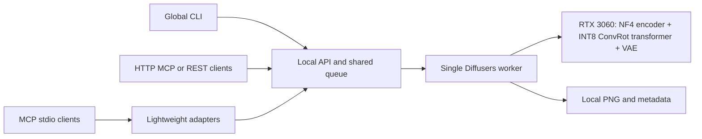

# FLUX3-MCP

Local FLUX 3 Image Klein generation and editing through **MCP, a global CLI, or HTTP**. One persistent worker owns the GPU models and serves every connected client through a shared queue.

Built and tested for an **NVIDIA RTX 3060 with 12 GB VRAM on Windows**:

- Official distilled **INT8 ConvRot image transformer**, running in Diffusers.
- **Qwen3-VL-4B text encoder in four-bit NF4**, plus the FLUX.2 VAE.
- The host agent supplies the final prompt. There is **no prompt upsampler**.
- No ComfyUI application, CPU model offloading, or automatic switch to another GPU.
- MCP over stdio and Streamable HTTP, plus REST and a command-line interface.

**Model weights are not included in this repository.** A separate setup command downloads the pinned files from Hugging Face into an ignored local directory.

## Contents

- [Measured results](#measured-results)
- [Requirements](#requirements)
- [Installation](#installation)
- [Generate and edit](#generate-and-edit)
- [Complete CLI reference](#complete-cli-reference)
- [Agent harness integration](#agent-harness-integration)
- [MCP tools](#mcp-tools)
- [HTTP API](#http-api)
- [Architecture and ConvRot loading](#architecture-and-convrot-loading)
- [GPU policy and request limits](#gpu-policy-and-request-limits)
- [Configuration and local files](#configuration-and-local-files)
- [Pinned models and dependencies](#pinned-models-and-dependencies)
- [Testing](#testing)
- [Troubleshooting](#troubleshooting)
- [Updating and removing the installation](#updating-and-removing-the-installation)
- [Attribution and model licenses](#attribution-and-model-licenses)

## Measured results

Single-image runs on RTX 3060 12 GB, driver 610.88, Python 3.12.9, CUDA PyTorch 2.14.1+cu130, 16 steps, seed 7, INT8 ConvRot transformer and NF4 encoder. The scene was a red teapot, edited to blue. Outputs were visually inspected.

| Operation | Resolution | Seconds | PyTorch peak reserved MiB | Driver peak dedicated MiB |
|---|---|---:|---:|---:|
| Generation, including cold loading and encoder quantization | 512 x 512 | 171.28 | 9,160 | 9,291.23 |
| Edit, one reference, models already loaded | 512 x 512 | 10.78 | 9,316 | 9,451.23 |
| Generation, models already loaded | 768 x 768 | 12.48 | 9,514 | 9,649.23 |
| Generation, models already loaded | 1024 x 1024 | 23.38 | 10,074 | 10,209.23 |
| Edit, one 1024-pixel reference, models already loaded | 1024 x 1024 | 54.97 | 10,662 | 10,797.24 |

The largest measured dedicated-memory peak was about **10.54 GiB**. Registered model parameters and buffers were audited on CUDA; CPU/disk mappings and offload hooks were rejected. Windows reported 78 MiB shared GPU memory during these runs. A separate small CUDA-allocation check reported 76 MiB without the model pipeline; shared counters include driver mappings and are not equivalent to model offloading.

These are observed runs for one scene, not latency percentiles or a guarantee for every prompt/reference combination. Allocator caches persist between jobs. See the [validation report](docs/gpu-validation.md) and [sanitized measurements](docs/benchmarks.json).

## Requirements

| Item | Requirement |
|---|---|
| OS | Windows x64; installer and global launcher are Windows-specific |
| GPU | RTX 3060 **12 GB**, with enough free memory for the worker |
| NVIDIA driver | Compatible with the bundled CUDA 13.0 PyTorch wheels; tested with 610.88 |
| Python | 3.12; setup installs a managed Python through uv when needed |
| Tools | [uv](https://docs.astral.sh/uv/getting-started/installation/) and Git |
| Storage | About 15 GB of model weights, plus Python packages, download caches, temporary files and outputs |
| Network | Required for initial installation/downloads; inference then reads local model files |
| Hugging Face | Access to both official repositories and authentication if their access controls require it |

Keep system RAM available for loading checkpoints, tokenization, image preprocessing, orchestration and normal CUDA staging. GPU-only model inference does not mean that the loader and operating system use no RAM.

The implementation deliberately requires a GPU name containing `RTX 3060`. Other GPU families are not enabled. A 3060 Ti or 6 GB variant is not the validated 12 GB target. Linux, WSL and macOS are not validated installation targets.

## Installation

### 1. Install uv and clone

In PowerShell:

```powershell
winget install --id=astral-sh.uv -e
```

Open a new terminal after installing uv, then clone into a permanent location:

```powershell
git clone https://github.com/abanerjee84/FLUX3-MCP.git
Set-Location FLUX3-MCP
```

The installation is editable. Keep this checkout in place: the launcher and MCP registrations point to its environment.

### 2. Install the environment

```powershell
powershell -ExecutionPolicy Bypass -File .\scripts\setup.ps1 -RegisterCodex
```

The execution-policy override applies to this PowerShell process. Setup installs managed Python 3.12 when needed, creates `.venv`, installs CUDA PyTorch and locked dependencies, installs this package, adds a launcher to the Windows user PATH, and optionally registers Codex MCP.

Omit `-RegisterCodex` if you do not use Codex. The default setup does not download models.

### 3. Enable model access and authenticate

Review both official repositories. If an access form is displayed, complete it using the same account as the local token:

- [black-forest-labs/flux-3-image-klein](https://huggingface.co/black-forest-labs/flux-3-image-klein)
- [black-forest-labs/flux-3-image-klein-comfy](https://huggingface.co/black-forest-labs/flux-3-image-klein-comfy)

```powershell
.\.venv\Scripts\hf.exe auth login
```

The `-comfy` repository supplies the official quantized checkpoint. Downloading it does not install or launch ComfyUI.

### 4. Download and verify weights

```powershell
.\.venv\Scripts\python.exe -m flux_image setup-models
```

Downloads resume after interruption. Large files use validated byte ranges and final SHA-256 checks before installation. No upsampler or base image-transformer weights are downloaded. BF16 encoder weights are downloaded as the source for NF4 quantization when loading.

If Hugging Face access is already configured, combine the installation and download:

```powershell
powershell -ExecutionPolicy Bypass -File .\scripts\setup.ps1 -DownloadModels -RegisterCodex
```

### 5. Verify from a new terminal

```powershell
flux-image doctor
flux-image start
```

`start` launches the API/MCP service. Models load on the first image job and remain resident for later calls. The first cold job includes loading and encoder quantization.

If PATH has not refreshed, use either form from the checkout:

```powershell
.\bin\flux-image.cmd doctor
.\.venv\Scripts\python.exe -m flux_image doctor
```

## Generate and edit

### Generate

Write a UTF-8 prompt file containing a complete scene caption:

```powershell
@'
Studio product photograph of one matte red ceramic teapot on a pale gray
tabletop, centered in a three-quarter view. A round body, curved handle on the
left, short spout on the right, and fitted lid. White seamless background.
Soft diffused light from the upper left, a gentle contact shadow, realistic
ceramic texture and crisp edges. No lettering or other objects.
'@ | Set-Content -Encoding utf8 prompt.txt

flux-image generate --prompt-file prompt.txt --width 1024 --height 1024 --seed 7 --out result.png
```

`--out` waits and saves a copy. The original PNG and JSON metadata sidecar stay in `data/outputs/`. The PNG also embeds the prompt, seed, model and memory metadata.

Inline prompts work too:

```powershell
flux-image generate --prompt "Studio photograph of a red ceramic teapot on a gray table, soft light from the left, plain white background." --out result.png
```

### Edit

```powershell
flux-image edit --image result.png --prompt-file edit.txt --width 1024 --height 1024 --seed 7 --out edited.png
```

Describe the complete desired result in `edit.txt`, incorporating the change. For this example, describe the same scene with a cobalt blue teapot. The host agent should inspect the reference before writing that caption. There is no local LLM that expands a short edit instruction.

Repeat `--image` for references:

```powershell
flux-image edit --image subject.png --image background.png --prompt-file composition.txt --out combined.png
```

The CLI accepts local file paths. MCP also accepts uploaded image IDs and previous successful job IDs.

### Submit without waiting

```powershell
flux-image generate --prompt-file prompt.txt --request-id poster-v1
```

Omit `--out` and `--wait` to receive a JSON job record immediately. Use its `job_id`:

```powershell
flux-image status JOB_ID
flux-image wait JOB_ID --timeout 600
flux-image download JOB_ID --out result.png
flux-image cancel JOB_ID
```

A stable request ID makes retries of the identical request return the original job and seed. A different request using that ID is rejected. Closing a client or timing out a wait does not cancel inference.

## Complete CLI reference

| Command | Behavior |
|---|---|
| `flux-image --help` | List commands |
| `flux-image doctor` | Check GPU inventory, models, dependencies and live service status |
| `flux-image start` | Start the shared daemon if needed |
| `flux-image serve` | Run the singleton service in the foreground |
| `flux-image stop` | Shut down this service and release its GPU process |
| `flux-image generate ...` | Submit text-to-image generation |
| `flux-image edit --image FILE ...` | Submit editing with one to four references |
| `flux-image status JOB_ID` | Read progress, status, errors and output metadata |
| `flux-image wait JOB_ID [--timeout SECONDS]` | Wait for completion; default 1800 seconds |
| `flux-image cancel JOB_ID` | Cancel pending work or request cancellation at an inference boundary |
| `flux-image download JOB_ID --out FILE` | Save the completed full-resolution PNG |
| `flux-image setup-models` | Download/resume and verify pinned weights |
| `flux-image install-cli` | Install the generated user-PATH launcher |
| `flux-image register codex` | Register MCP at Codex user scope |
| `flux-image register claude-code` | Register MCP at Claude Code user scope |
| `flux-image register gemini` | Register MCP at Gemini CLI user scope |
| `flux-image register-codex` | Alias for Codex registration |
| `flux-image mcp-config` | Print generic stdio MCP configuration |
| `flux-image mcp-config --http` | Print HTTP MCP endpoint information |
| `flux-image mcp` | Run the stdio adapter, normally launched by a harness |

Shared generation/editing options:

| Option | Meaning | Default |
|---|---|---|
| `--prompt TEXT` | Inline caption, mutually exclusive with `--prompt-file` | One prompt input required |
| `--prompt-file FILE` | Read a UTF-8 caption | One prompt input required |
| `--width INTEGER` | Output width | 768 |
| `--height INTEGER` | Output height | 768 |
| `--steps INTEGER` | Sampling steps | 16 |
| `--seed INTEGER` | Seed from 0 to 4294967295 | Random |
| `--request-id TEXT` | Retry identity for an identical request | Unset |
| `--wait` | Wait for completion | Off |
| `--timeout SECONDS` | Wait limit, not an inference cancellation timer | 1800 |
| `--out FILE` | Save a copy after success; implies waiting | Unset |

`edit` additionally requires `--image FILE`; repeat it up to four times. Use `flux-image COMMAND --help` for specific help.

Results are JSON on stdout. Reported command errors are JSON on stderr and return nonzero exit codes. A submission that has not waited cannot report a later inference failure: inspect its final status.

## Agent harness integration

### Automatic registration

```powershell
flux-image register codex
flux-image register claude-code
flux-image register gemini
```

| Harness | User-level file |
|---|---|
| Codex | `~/.codex/config.toml`, or `$CODEX_HOME/config.toml` |
| Claude Code | `~/.claude.json`, top-level `mcpServers` |
| Gemini CLI | `~/.gemini/settings.json`, top-level `mcpServers` |

Registration adds only `local-flux`, backs up existing configuration before writing, preserves unrelated settings, and refuses to replace a conflicting entry under that name. Restart the harness to discover its tools. Registration does not bypass tool approvals or sandbox rules.

### Other stdio clients

Print paths for the actual installation:

```powershell
flux-image mcp-config
```

Or adapt [mcp-config.example.json](mcp-config.example.json), replacing both paths:

```json
{
  "mcpServers": {
    "local-flux": {
      "command": "C:/AI/FLUX3-MCP/.venv/Scripts/python.exe",
      "args": ["-m", "flux_image", "mcp"],
      "env": {"FLUX_IMAGE_HOME": "C:/AI/FLUX3-MCP/data"}
    }
  }
}
```

Every adapter forwards calls to the same daemon; it does not load another model. Absolute executable/data paths make registration independent of the active project directory.

### HTTP MCP

Start the service and configure a Streamable HTTP client for `http://127.0.0.1:8765/mcp`. Send `Authorization: Bearer <local-token>` using the token in `data/config.json`. The endpoint uses standard SSE streaming responses, not the deprecated standalone SSE transport. `mcp-config --http` prints the endpoint, not the token.

Clients differ in how they configure headers. Use that client's format for the URL and bearer header. This project creates no public tunnel or remote listener.

### Without MCP

Give the harness shell access to the CLI or integrate REST. A useful persistent instruction is:

> Use `flux-image` for local image generation and editing. Supply a complete target-scene caption. Submit a job, poll it to completion, and inspect the resulting image. The service has no prompt upsampler. Use absolute input/output paths when the working directory is uncertain.

There is no registry that automatically enables a tool in every agent product. Each harness needs an MCP registration, shell access with usage instructions, or HTTP integration. Cloud agents need an explicitly configured connection to this computer; they cannot access its localhost or Windows paths directly.

## MCP tools

| Tool | Inputs | Result |
|---|---|---|
| `generate_image` | `prompt`; optional `width`, `height`, `steps`, `seed`, `client_request_id` | Job record immediately |
| `upload_image` | `image_path`, local to the service computer | Uploaded `image_id` and dimensions |
| `edit_image` | `prompt`, `reference_images`; optional generation settings | Job record immediately |
| `get_image_job` | `job_id`; optional `include_preview=false` | Job record; optional PNG content after success |
| `cancel_image_job` | `job_id` | Current job record |
| `image_service_status` | None | Readiness, selected GPU, placement policy, download progress and latest memory metrics |

MCP `reference_images` accepts uploaded IDs, successful job IDs, or absolute local paths, with one to four references. Clients without shared Windows filesystem access can upload bytes using REST and pass the returned IDs.

Call `generate_image` or `edit_image`, then poll `get_image_job` until `succeeded`, `failed`, or `cancelled`. Request `include_preview=true` after success to attach an image. Previews are limited to 768 pixels on the longest side; saved PNGs and REST downloads retain full resolution.

## HTTP API

All endpoints require the generated local bearer token. The service listens on `127.0.0.1`, default port 8765.

| Method | Route | Purpose |
|---|---|---|
| GET | `/health` | Readiness and selected GPU |
| POST | `/v1/images` | Upload raw image bytes and receive an image ID |
| POST | `/v1/jobs` | Submit JSON; returns HTTP 202 and a job record |
| GET | `/v1/jobs/{job_id}` | Read progress and results |
| POST | `/v1/jobs/{job_id}/cancel` | Request cancellation |
| GET | `/v1/jobs/{job_id}/image` | Download a successful job's PNG |
| POST | `/admin/shutdown` | Stop a service started by this CLI |
| GET | `/openapi.json` | OpenAPI schema |
| GET | `/docs` | Interactive API documentation, also authenticated |

Start the service first with `flux-image start`. Unlike the CLI and stdio adapter, a raw REST request does not auto-start it. This Python example runs from the checkout:

```python
import json
import time
from pathlib import Path

import httpx

config = json.loads(Path("data/config.json").read_text(encoding="utf-8"))
with httpx.Client(
    base_url=f"http://127.0.0.1:{config['port']}",
    headers={"Authorization": "Bearer " + config["token"]},
    trust_env=False,
    timeout=30,
) as client:
    response = client.post("/v1/jobs", json={
        "prompt": "Studio photograph of a red ceramic teapot, gray tabletop, white background, soft light from the left.",
        "width": 768, "height": 768, "steps": 16, "seed": 7,
        "client_request_id": "example-teapot-v1",
    })
    response.raise_for_status()
    job_id = response.json()["job_id"]

    while True:
        response = client.get(f"/v1/jobs/{job_id}")
        response.raise_for_status()
        job = response.json()
        if job["status"] in {"succeeded", "failed", "cancelled"}:
            break
        time.sleep(1)

    if job["status"] != "succeeded":
        raise RuntimeError(job.get("error") or job["status"])
    response = client.get(f"/v1/jobs/{job_id}/image")
    response.raise_for_status()
    Path("result.png").write_bytes(response.content)
```

For editing, upload each reference as a raw body to `/v1/images`, then put its `image_id` in the job's `reference_images` array. REST job submissions take uploaded IDs, not arbitrary file paths.

Common responses: 400 invalid image, 401 missing/wrong authentication, 403 rejected origin, 404 unknown ID, 409 conflicting request ID or image not ready, 413 oversized upload, 422 invalid settings, and 429 full queue. Loading/CUDA failures happen asynchronously and appear in the job's `error` field.

## Architecture and ConvRot loading



The CLI or stdio adapter starts the daemon on demand. Process locks prevent duplicate workers for one data directory. A SQLite queue persists jobs, admits up to 32 queued/running requests, and executes one image at a time. Queued jobs survive a restart; interrupted running jobs are marked failed rather than silently retried.

The official INT8 checkpoint is packaged for ComfyUI, so ordinary Diffusers loading is insufficient. [`_convrot.py`](src/flux_image/_convrot.py) bridges it by creating a Diffusers transformer with empty weights, reading INT8 tensors/scales/ConvRot metadata, mapping layer names and splitting fused QKV tensors, and installing custom linear layers backed by standalone `comfy-kitchen` kernels. It converts the remaining floating-point tensors and checks shapes and missing/meta tensors before inference.

The transformer keeps INT8 weights and FP32 scales rather than expanding into a full BF16 model at loading. `comfy-kitchen` is a kernel library; the ComfyUI application is not a dependency. All 258 quantized layer mappings were checked against the target architecture, followed by real generation and editing.

The text encoder converts the host's caption to embeddings and remains necessary without a prompt upsampler. NF4 encoding leaves memory for the image model and VAE. The distilled model defaults to 16 steps without classifier-free guidance, scheduler shift 16.0, and GPU VAE tiles with a 256-pixel sample size.

## GPU policy and request limits

- The GPU UUID is selected before importing PyTorch. Other GPUs are hidden from the worker.
- Automatic selection needs exactly one matching RTX 3060. Missing or ambiguous selection never silently falls back to another device.
- The encoder has an explicit CUDA mapping. There is no `device_map="auto"` or CPU/disk model-offloading path.
- Registered model parameters and buffers must be on CUDA after loading and after each successful inference. CPU/disk mappings and offload hooks are rejected.
- The default PyTorch allocation budget is 10.5 GiB, also bounded by device capacity minus 1.5 GiB. This is not a driver-wide reservation.
- Windows PDH counters sample per-process dedicated/shared GPU memory separately from PyTorch allocated/reserved memory.
- Allocation/residency failures fail the job; the worker does not substitute a CPU path or another quantization format.

A CUDA label and allocator cap alone do not prove physical residency under all Windows driver conditions. Audits, headroom and driver measurements provide evidence for the tested runs. Other GPU consumers, longer captions and reference combinations can change the peak.

| Setting | Current limit |
|---|---|
| Batch | One output image per job |
| Dimensions | 256 through 2048 per axis, multiples of 16 |
| Output area | At most 1,048,576 pixels, including 1024 x 1024 |
| Steps | 4 through 16 |
| References | One through four for editing |
| Reference preprocessing | Combined approximately 1 MP budget divided across references |
| Upload | At most 32 MiB and 16 MP per image |
| Prompt | At most 16,000 characters; backend also enforces a 1024-token caption budget |
| Queue | At most 32 queued/running jobs |

Multi-reference and extreme-aspect-ratio inputs are not exhaustively validated. Measured edits used one reference. Limits are safeguards, not a promise of identical memory use or quality for every request. NF4 encoder results are not expected to be pixel-identical to a BF16 encoder.

## Configuration and local files

The default data root is `<checkout>/data`. Override with `FLUX_IMAGE_HOME`, set consistently for the service, CLI and adapters. Different roots are separate installations; they do not share model instances/jobs and must use non-conflicting ports.

| Path | Contents |
|---|---|
| `.venv/` | Private packages and executables |
| `bin/flux-image.cmd` | Generated launcher with this installation's absolute Python path |
| `data/config.json` | Port, selected GPU UUID, allocation budget and local bearer token |
| `data/models/` | Weights, resume/verification records and model manifest |
| `data/inputs/` | Normalized reference copies |
| `data/outputs/` | Generated PNGs and JSON metadata |
| `data/jobs.sqlite3` | Queue and history |
| `data/service.log` | Daemon log |
| `data/gpu-validation.json` | Hardware report, if validation was run |

The config contains `port` (8765), `gpu_uuid`, `memory_gib` (10.5) and `token`. Stop the service/adapters before changing it. Do not copy it unchanged to a new machine: its UUID and token are installation-specific. Run `doctor` to inspect GPUs.

`FLUX_DOWNLOAD_WORKERS` controls download concurrency, 1 through 8, default 6. Downloads use 16 MiB ranges with up to five attempts per range and final SHA-256 verification. A bad hash is not installed as a usable checkpoint.

Runtime state, weights, generated launchers, logs, secrets, caches and images are ignored by Git. Keep config/tokens/harness backups private. The API requires authentication, validates origins, and binds to loopback; it is not a public multi-user hosting service. Stdio adapters inherit the host user's filesystem access.

## Pinned models and dependencies

| Component | Pinned source |
|---|---|
| Pipeline config, encoder source and VAE | `black-forest-labs/flux-3-image-klein` at `337337621b8526e120f2275d250242f4a6bedd75` |
| Official ConvRot transformer | `black-forest-labs/flux-3-image-klein-comfy` at `5c9b714851dc072b04a23ef6d2d36421f5ccb3a0` |
| Transformer file at that revision | `diffusion_models/flux3_image_klein_sd_int8_convrot.safetensors` |
| Diffusers | `d42ebf9c6e0b46103b74283f5324357a67acaa04` |
| Transformers | `966f59c897c15db8a5e14882d086beba8d6d0b9f` |
| PyTorch / torchvision | `2.14.1+cu130` / `0.29.1+cu130` |
| comfy-kitchen / bitsandbytes | `0.2.37` / `0.50.2` |

The pinned checkpoint has an older name than the current repository files. Keep its revision and filename together rather than replacing only the filename.

[`requirements.lock.txt`](requirements.lock.txt) records the tested environment. Setup installs CUDA wheels from the PyTorch CUDA 13.0 index before the lock file. [`pyproject.toml`](pyproject.toml) defines the package and CLI entry point; [`models.py`](src/flux_image/models.py) pins model revisions. Inference uses local-only loading and sets Hugging Face/Transformers offline flags in the worker.

## Testing

From the checkout:

```powershell
.\scripts\test.ps1
.\.venv\Scripts\ruff.exe check src tests scripts/validate_gpu.py scripts/validate_mcp_live.py
.\.venv\Scripts\python.exe -m compileall -q src
```

Eight automated checks cover serialization, idempotency, queued/running cancellation, restart recovery, authentication, images, input limits, preserving harness configuration, and real MCP sessions over stdio/HTTP. Test backends are injected only by tests; missing models never cause the application to return placeholder images.

Hardware checks perform real inference:

```powershell
.\.venv\Scripts\python.exe scripts/validate_gpu.py --wait-for-models
.\.venv\Scripts\python.exe scripts/validate_mcp_live.py
```

The first waits for models, restarts this service, generates at 512/768/1024 pixels and edits at 512 pixels, writing reports/images under `data/`. The published 1024-pixel edit was an additional run. The second requires that GPU report, performs an edit through stdio MCP, and retrieves an image preview through HTTP MCP. Both consume the GPU. Inspect output quality when validating a new environment.

## Troubleshooting

| Symptom | Action |
|---|---|
| Command not recognized | Open a new terminal; use `bin/flux-image.cmd` or `.venv/Scripts/python.exe -m flux_image` from the checkout. Re-run `install-cli` if needed. |
| Hugging Face 403 | Confirm access to both repositories with the account behind the local token, including the separate `-comfy` repository. Reauthenticate if the account is wrong. |
| Interrupted download | Re-run `setup-models`; completed ranges are reused and hashes are checked. |
| Certificate failure | Setup uses system certificates and downloads use the OS trust store. Install the required corporate/root certificate; do not disable TLS validation. |
| `Inference not ready` | Check `doctor` for missing files/dependencies, then run model setup. |
| GPU UUID unavailable | Inspect `doctor`; stop the service before fixing a stale local UUID. This build targets RTX 3060. |
| CUDA out of memory | Stop other selected-GPU work, reduce dimensions/references and inspect job metrics. No CPU fallback is enabled. |
| Slow first job | Loading and NF4 quantization are included. Keep the daemon running for warm calls. |
| MCP tools absent | Restart the harness after registration; check that `local-flux` is enabled and local execution is permitted. |
| Conflicting registration | Inspect the existing `local-flux` entry and backup; the command refuses to overwrite a different entry. |
| HTTP 401 | Use this installation's generated bearer token, not the Hugging Face token. |
| API docs need authentication | `/docs` is authenticated too. Use an authenticated client or inspect `/openapi.json`. |
| Service does not start | Inspect `data/service.log` and check for a port conflict or another worker sharing the data root. |
| Wait timed out | Read the same job with `status` or `wait`; the timeout does not cancel it. |
| Remote path cannot be read | Paths refer to the service computer; upload/download bytes or configure an explicit host connection. |

For startup debugging, stop the daemon and use `flux-image serve` in the foreground. Cancellation is cooperative at stage/denoising boundaries; it does not promise an immediate interruption of weight loading.

## Updating and removing the installation

```powershell
flux-image stop
git pull --ff-only
powershell -ExecutionPolicy Bypass -File .\scripts\setup.ps1
```

Re-register if you move the checkout or replace its environment. Existing conflicting entries need inspection; moving a folder does not fix absolute executable paths.

There is no automatic uninstaller. Stop the service, remove only its `local-flux` entries from registered harnesses, remove this checkout's `bin` directory from your user PATH, then remove the checkout after retaining any outputs you need. Hugging Face authentication and uv's Python/cache are separate user resources.

## Attribution and model licenses

The ConvRot loader is adapted from [animede/flux3-klein-studio](https://github.com/animede/flux3-klein-studio). Its Apache 2.0 notice is retained. See [THIRD_PARTY_NOTICES.md](THIRD_PARTY_NOTICES.md) and the [included upstream license](vendor/LICENSE.animede).

Model weights are separate downloads retaining their publishers' terms. This repository does not distribute them or replace their licenses. Review the [FLUX 3 Image Klein license](https://huggingface.co/black-forest-labs/flux-3-image-klein/blob/main/LICENSE.md) for the intended use. Dependencies retain their respective licenses.
